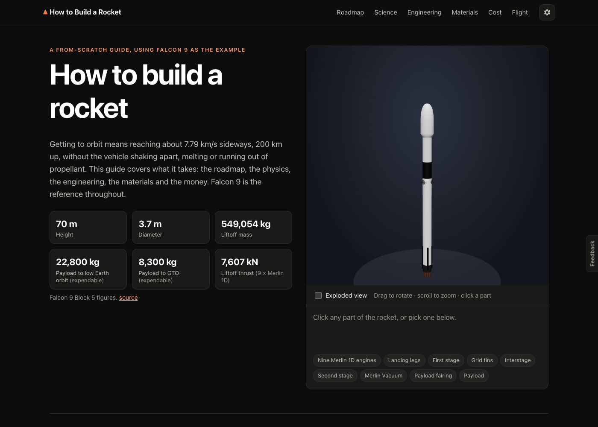
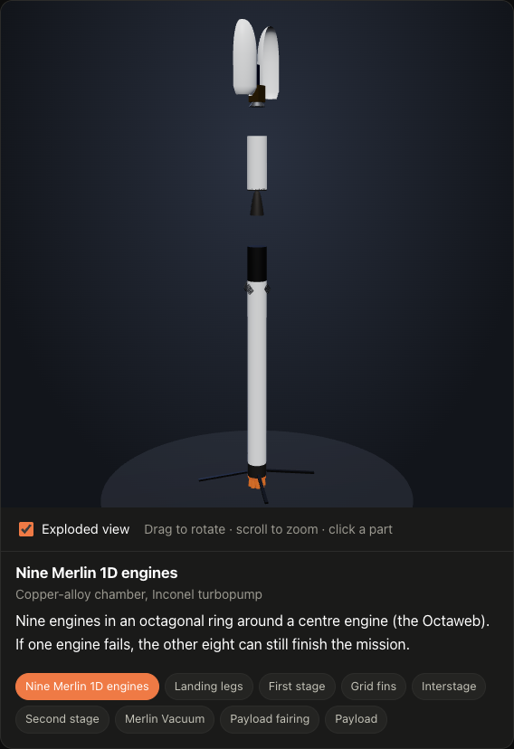
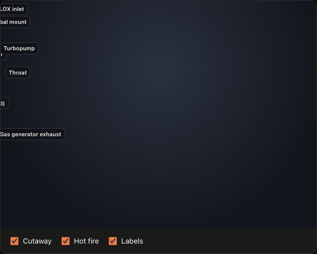
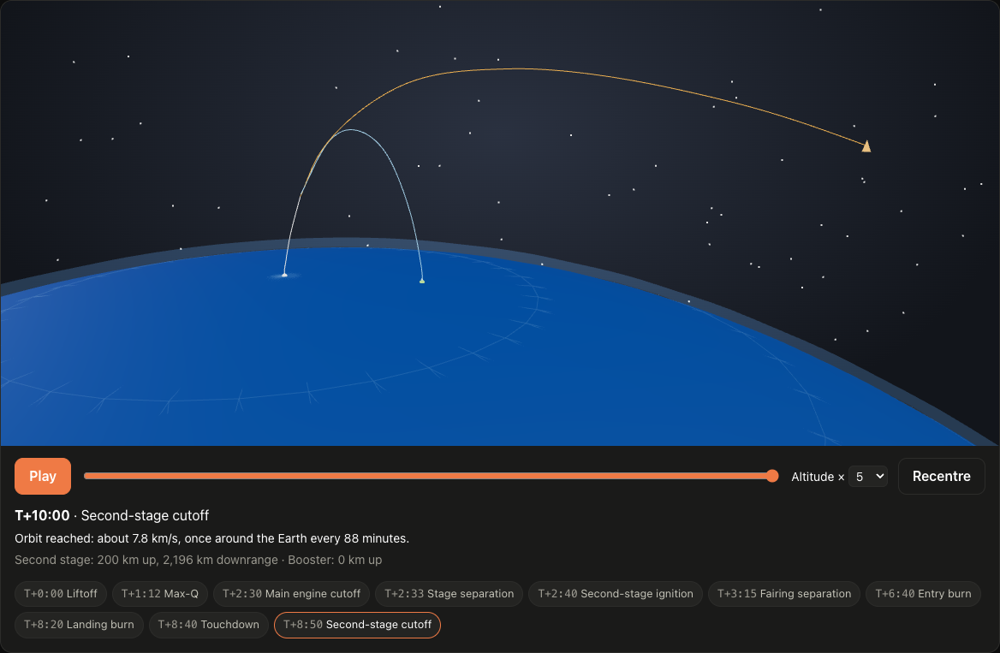
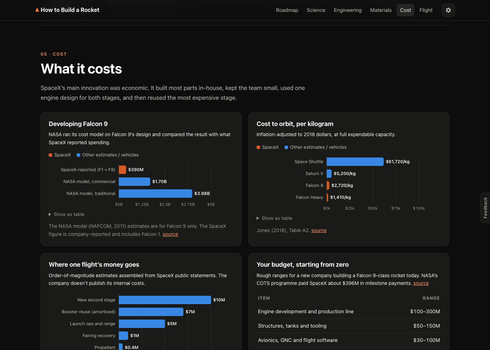
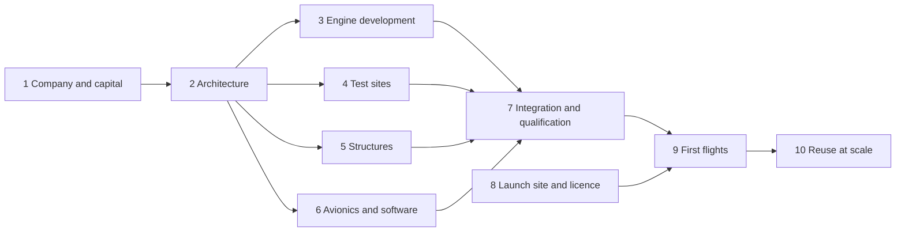

# How to Build a Rocket

A from-scratch roadmap to an orbital rocket, using Falcon 9 as the example: the physics, engineering, materials and cost, with interactive 3D models.

**[Open the site →](https://amalmehta.github.io/HowToBuildARocket/)**

| Falcon 9, exploded | Merlin 1D cutaway, hot fire | Ten minutes to orbit |
|---|---|---|
|  |  |  |

## Links

- [Instructions](docs/INSTRUCTIONS.md): use it, run it locally, test it
- [System design](docs/SYSTEM-DESIGN.md): architecture, flows, decisions, limits
- [File structure](docs/FILE-STRUCTURE.md): what's where
- [Project brief](how_to_build_a_rocket.md)
- [Send feedback](https://github.com/amalmehta/HowToBuildARocket/issues/new)
