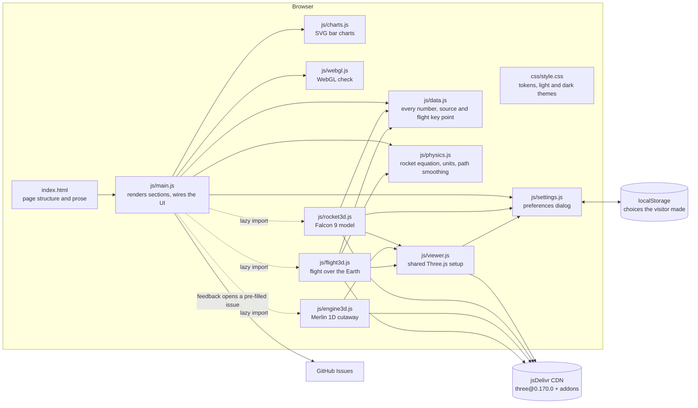

# System Design

How to Build a Rocket is a static website: one HTML page, one stylesheet and a handful of ES modules. There is no build step, server or database. GitHub Pages serves the files as they are.

## Architecture

`main.js` never imports Three.js directly. It checks WebGL through `webgl.js` and reaches the 3D modules only through dynamic `import()`, so if the CDN is blocked the text, tables, charts, calculator and settings still work, and each 3D panel shows a message.

## Components

| Component | Job |
|---|---|
| `index.html` | Page structure, the written explanations, the gas-generator cycle diagram (inline SVG), the Settings and Feedback dialogs, social-sharing metadata and a `<noscript>` note. Loads Three.js through an import map, with `modulepreload` hints. Prose numbers that change with units are `` elements. |
| `js/data.js` | The single source of truth for figures: specs (with stable `id`s), stage masses, engine facts, the roadmap, materials, costs, flight events, flight-path key points and sources. Every charted or notable figure has a source key; estimates are flagged. Text can hold `{q:value:unit}` tokens that render in the visitor's units. |
| `js/physics.js` | Pure functions with no DOM: the rocket equation, two-stage Δv (with the fairing carried into the second-stage burn), maximum payload by bisection, circular orbital speed, thrust-to-weight, metric/imperial conversion, `{q:…}` token filling, and a monotone cubic interpolator for the flight paths. Shared by the page and the tests. |
| `js/main.js` | Renders the stat tiles, roadmap, engine facts, materials table, budget and sources. Builds the charts once and updates them in place when units change. Runs the calculator, lazily mounts the 3D scenes (applying any restored checkbox state), and handles the feedback dialog and nav. Each start-up step is isolated so one failure can't blank the page. |
| `js/charts.js` | Horizontal SVG bar charts: round axis steps (`niceScale`), measured label widths with a stacked layout on narrow screens, negative bars, a legend, hover/focus tooltips (Escape closes them), one tab stop per chart with arrow-key navigation, and a "Show as table" view. `update()` keeps the table's open state and focus. |
| `js/settings.js` | Theme, units, 3D quality, motion and auto-rotate, with allowed values in `OPTIONS`. Only choices the visitor makes are saved; stored values are validated. "Match system" follows OS theme and reduced-motion changes live. Opens with the gear button or ⌘, / Ctrl+, (not while typing, not over another dialog). |
| `js/webgl.js` | WebGL availability check that releases its probe context. |
| `js/viewer.js` | Shared Three.js setup: renderer, camera, orbit controls, optional default lights, resize and pixel-ratio tracking (capped at 1.5×), render-on-demand, pausing off screen, WebGL context-loss handling, keyboard orbit (arrows, +/−), scroll-wheel zoom only with ⌘/Ctrl or after clicking in, vertical swipes left to page scrolling, and primary-button click-to-pick. |
| `js/rocket3d.js` | A procedural Falcon 9 at real scale (1 unit = 1 m): nine Merlins (expansion ratio ≈ 16) under an Octaweb shield, a painted first stage (soot, weld seams), raceways, landing legs with struts and footpads (about 18 m span), titanium grid fins and cold-gas thruster pods on the interstage, a hollow carbon interstage, Merlin Vacuum (≈ 165:1), second stage, a two-part fairing and a satellite. Side key light, image-based lighting (RoomEnvironment) and a soft shadow map that only redraws while the exploded view animates. Grid fins and engines are merged into one mesh per material. Part selection swaps in cached highlight materials. |
| `js/engine3d.js` | A procedural Merlin 1D with the same nozzle profile: chamber and bell, turbopump, gas-generator exhaust, LOX/RP-1 lines, a clipping-plane cutaway of every part, an inner wall that goes from copper to glowing orange, a shader plume with shock diamonds in its core, a camera that eases out to fit the plume, and CSS2D labels that hide when their part faces away. |
| `js/flight3d.js` | Earth at 1 unit = 100 km with smooth latitude/longitude circles and a fresnel atmosphere. Stack, second-stage and booster paths come from key points in `data.js`, smoothed with monotone interpolation, drawn as thick lines. The camera fits everything drawn so far for any viewer shape. Play, scrub, event list, altitude exaggeration; playback pauses when scrolled off screen. |

## Main flows

1. **Page load.** `main.js` applies saved settings, renders all text sections and charts from `data.js`, then mounts the rocket model. The engine and flight scenes are imported when they scroll within 300 px of the screen. Each 3D panel shows "Loading…" and is `aria-busy` until mounted; the flight controls stay disabled until the scene is ready.
2. **Calculator.** Slider input → `twoStage()` gives stage 1 and stage 2 Δv. That's compared with the Δv budget total (sum of `DV_BUDGET`, about 8,930 m/s), and `maxPayload()` bisects for the most payload that still reaches orbit. Defaults reproduce Falcon 9: about 22.6 t expendable (published 22.8 t), about 17 t with a 10% landing reserve (published at least 17.4 t). Screen readers hear the verdict when a slider is released.
3. **Settings change.** `setSetting()` saves the choice, updates `<html>` attributes (CSS tokens switch theme and motion) and fires `settingschange`. If units changed, every `.q` quantity is reformatted, the charts update in place and the calculator re-runs. If quality, motion or auto-rotate changed, the 3D viewers update their pixel ratio and auto-rotate (which stays off once the visitor has dragged a model).
4. **3D picking.** A primary-button click or single tap (moved less than 5 px) raycasts into the rocket, walks up to the nearest group with `userData.part`, highlights it and shows its card, with figures in the visitor's units. The chip buttons do the same from the keyboard; pressing the selected chip again clears it.
5. **Flight playback.** Time advances at 20× while playing. Each frame updates the trails, the vehicle markers and a per-frame readout; the live status line changes only when a new event is reached.
6. **Feedback.** The tab (or the footer link on phones) opens a dialog. On submit it opens a pre-filled `github.com/amalmehta/HowToBuildARocket/issues/new` page, with the body capped at 6,000 characters. Nothing is sent until the visitor submits on GitHub.

## Where data lives

- **Content and figures:** `js/data.js`, versioned in git. A few headline figures also appear in the prose of `index.html` (as `.q` spans, so they still convert units).
- **Preferences:** the visitor's `localStorage` key `rocket-settings`, holding only the settings they changed. Reads are validated against `OPTIONS`, and every read and write is wrapped in try/catch, so the site falls back to defaults when storage is blocked or corrupt.
- **Third-party:** Three.js r170 and its addons from jsDelivr, pinned by version.

## Key decisions and trade-offs

| Decision | Why | Trade-off |
|---|---|---|
| Static site, no build step | Nothing to install, so GitHub Pages hosts it free and it's easy to read. | No bundling or minification. Three.js comes from a CDN at runtime. |
| Procedural 3D models instead of downloaded meshes | No licensing questions, tiny download, every dimension traceable to the real vehicle. | Simplified shapes: no plumbing detail or logos. |
| Three separate WebGL renderers | Each scene stays self-contained and simple. | More GPU memory than one shared renderer; mitigated by render-on-demand, a 1.5× pixel-ratio cap, pausing off screen and context-loss handling. |
| One data file with source keys | Every number on the page can be traced and corrected in one place. Tests check that every source is cited and every cited key exists. | Prose in `index.html` repeats a few headline figures, which have to be kept in sync by hand. |
| Ideal rocket equation plus a fixed loss budget | Simple to explain, and reproduces Falcon 9's published payloads to within about 3%. | Not a trajectory simulation. Losses are at the optimistic end and don't change with the design. |
| Key-point flight paths with monotone smoothing | Stable, testable, and checked against simple physics (MECO about 2.2 km/s, ballistic booster apogee about 133 km, orbital ground speed about 7.55 km/s). | Paths are illustrative, not a flown trajectory. |
| Hand-rolled SVG charts | No chart library. Themed through CSS tokens, accessible by keyboard and as tables. | Only horizontal bars are supported. |
| Content site, not an application | The deliverable is a website to read, so there is no Mac app. It still has a settings dialog and a feedback tab because it has interactive 3D and units. | — |

## Style

British spelling and sentence case. Acronyms are spelled out at first use.

## Testing

- `npm test` runs `node --test tests/*.test.js`. There are 24 tests across three files:
  - `tests/physics.test.js` (7): the rocket equation against a hand calculation, orbital speed at 200 km, liftoff thrust-to-weight of about 1.4, stage estimates against the published liftoff mass (within 2%), expendable Falcon 9 against the Δv budget (within 5%), payloads against the published 22.8 t (within 3%) and 17.4 t (15.5–18.5 t band), and unit conversion (including no "−0" and one imperial speed unit).
  - `tests/data.test.js` (11): complete materials rows; 3D parts match their info entries; every source is cited and every cited key exists; charted numbers are sourced; flight events are ordered; flight tracks join up and match the event times and droneship position; smoothed tracks pass through their key points without dipping below ground or going backwards; calculator slider defaults match the stage estimates and sit on their step grid; settings defaults match the dialog and storage is sanitised; chart helpers; unit tokens.
  - `tests/site.test.js` (6): every element ID the scripts look up exists; every local file the page references exists; source keys on the page are defined; nav links point to sections; README and docs links resolve; the 404 page and share image exist.
- Visual check, done by hand (not in `npm test`): headless Chrome (SwiftShader WebGL) screenshots of every section in light and dark at desktop and phone widths, checking for console errors and horizontal overflow. The README screenshots and `share.png` come from this pass.

## Known limits

- Needs WebGL for the three 3D scenes. Without it, or if the CDN can't be reached, each scene shows a short message and the rest of the page still works.
- Stage masses, chamber conditions, per-flight cost shares and the new-company budget are estimates. SpaceX doesn't publish them. They are labelled on the page.
- The calculator uses a constant average Isp for stage 1 and ignores throttling, so it can't model engine-out or different trajectories.
- The flight paths are illustrative, and altitude is exaggerated 5× by default.
- The engine cutaway shows zero-thickness walls rather than a solid section.
