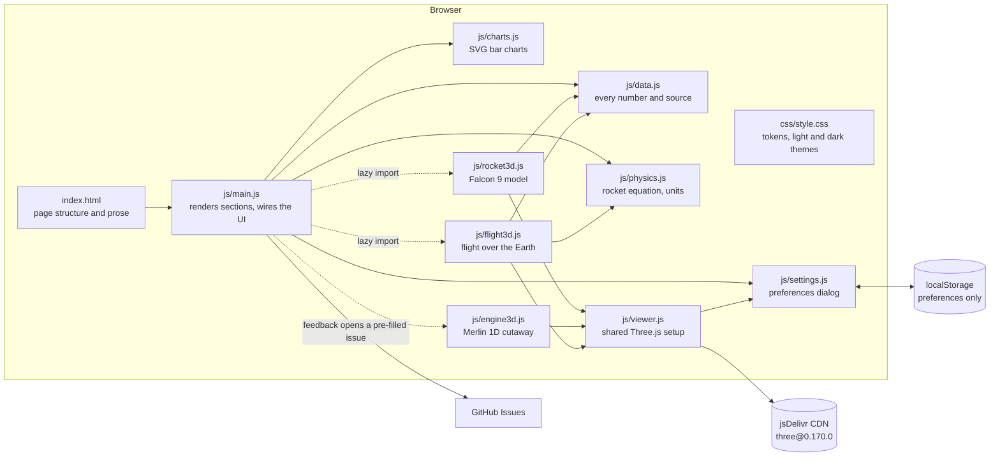

# System Design

How to Build a Rocket is a static website: one HTML page, one stylesheet and a handful of ES modules. There is no build step, server or database. GitHub Pages serves the files as they are.

## Architecture

## Components

| Component | Job |
|---|---|
| `index.html` | Page structure, the written explanations, the gas-generator cycle diagram (inline SVG), and the Settings and Feedback dialogs. Loads Three.js through an import map. |
| `js/data.js` | The single source of truth for figures: specs, stage masses, the roadmap, materials, costs, flight events and sources. Each figure is tagged with a source key, and estimates are flagged. |
| `js/physics.js` | Pure functions with no DOM: the rocket equation, two-stage Δv, maximum payload by bisection, circular orbital speed, thrust-to-weight, and metric/imperial conversion. Shared by the page and the tests. |
| `js/main.js` | Renders the stat tiles, roadmap, materials table, budget, sources and charts. Runs the rocket-equation calculator. Lazily mounts the 3D scenes. Handles the feedback dialog and nav highlighting. |
| `js/charts.js` | Draws horizontal SVG bar charts with a legend, hover/focus tooltips and a "Show as table" view. Redraws on resize. |
| `js/settings.js` | Theme, units, 3D quality, motion and auto-rotate. Opens with the gear button or ⌘, / Ctrl+,. Writes to `<html data-theme>` and fires a `settingschange` event. |
| `js/viewer.js` | Shared Three.js setup: renderer, camera, orbit controls, lights, resize handling, pause when off screen, and click-to-pick. |
| `js/rocket3d.js` | A procedural Falcon 9 at real scale: 9 engines, legs, grid fins, interstage, second stage, MVac, a fairing in two halves and a satellite. Includes the exploded view and part selection. |
| `js/engine3d.js` | A procedural Merlin 1D: chamber and bell nozzle, turbopump, gas generator exhaust, LOX/RP-1 lines, a clipping-plane cutaway, a shader plume with shock diamonds, and CSS2D labels. |
| `js/flight3d.js` | Earth at 1 unit = 100 km, with smooth stack, second-stage and booster paths through key points. Has play, scrub and altitude exaggeration. |

## Main flows

1. **Page load.** `main.js` applies saved settings, renders all text sections and charts from `data.js`, then mounts the rocket model. The engine and flight scenes are only imported when they scroll within 300 px of the screen. `modulepreload` links start downloading them early.
2. **Calculator.** Slider input → `twoStage()` gives stage 1 and stage 2 Δv. That's compared with the Δv budget total (sum of `DV_BUDGET`), and `maxPayload()` bisects for the most payload that still reaches orbit.
3. **Settings change.** `setSetting()` saves to localStorage, updates `<html>` attributes (CSS tokens switch theme) and fires `settingschange`. Listeners re-format every quantity, redraw the charts, re-run the calculator and update the 3D pixel ratio and auto-rotate.
4. **3D picking.** A click (pointer moved less than 5 px) raycasts into the rocket, walks up to the nearest group with `userData.part`, highlights it and shows its card. The chip buttons give the same thing via keyboard.
5. **Feedback.** The tab opens a dialog. On submit it opens a pre-filled `github.com/amalmehta/HowToBuildARocket/issues/new` page. Nothing is sent until the visitor submits on GitHub.

## Where data lives

- **Content and figures:** `js/data.js`, versioned in git.
- **Preferences:** the visitor's `localStorage` key `rocket-settings`. Every read and write is wrapped in try/catch, so the site falls back to defaults when storage is blocked.
- **Third-party:** Three.js r170 from jsDelivr, pinned by version.

## Key decisions and trade-offs

| Decision | Why | Trade-off |
|---|---|---|
| Static site, no build step | Nothing to install, so GitHub Pages hosts it free and it's easy to read. | No bundling or minification. Three.js comes from a CDN at runtime. |
| Procedural 3D models instead of downloaded meshes | No licensing questions, tiny download, every dimension traceable to the real vehicle. | Simplified shapes: no plumbing detail, logos or textures. |
| One data file with source keys | Every number on the page can be traced and corrected in one place. | Prose in `index.html` repeats a few headline figures (e.g. 72 s max-Q), which have to be kept in sync by hand. |
| Ideal rocket equation plus a fixed loss budget | Simple to explain, and reproduces Falcon 9's published 22.8 t (model gives about 22.3 t). | Not a trajectory simulation. Losses don't change with the design. |
| Smooth key-point flight paths instead of physics integration | Looks right and stays stable. Event times match a typical mission. | Paths are illustrative, not a flown trajectory. |
| Hand-rolled SVG charts | No chart library. Themed through CSS tokens. | Only horizontal bars are supported. |
| Content site, not an application | The deliverable is a website to read, so there is no Mac app. It still has a settings dialog and a feedback tab because it has interactive 3D and units. | — |

## Testing

- `npm test` runs `node --test tests/*.test.js`:
  - `tests/physics.test.js` checks the rocket equation against a hand calculation, orbital speed at 200 km, liftoff thrust-to-weight of about 1.4, that the stage estimates add up to the published liftoff mass (within 2%), that expendable Falcon 9 reaches the Δv budget (within 5%), that a landing reserve costs payload, and unit conversion.
  - `tests/site.test.js` checks that every element ID the scripts look up exists in `index.html`, that every script and stylesheet the page references exists, that every source key used is defined, and that the nav links point to real sections.
- Visual check: headless Chrome screenshots of every section in light and dark at desktop and phone widths, checking for console errors and horizontal overflow. The README screenshots come from this pass.

## Known limits

- Needs WebGL for the three 3D scenes. Without it they show a short message and the rest of the page still works.
- Needs network access to jsDelivr for Three.js.
- Stage masses, chamber conditions, per-flight cost shares and the new-company budget are estimates. SpaceX doesn't publish them. They are labelled on the page.
- The calculator uses a constant average Isp for stage 1 and ignores throttling, so it can't model engine-out or different trajectories.
- The flight paths are illustrative, and altitude is exaggerated 5× by default.
